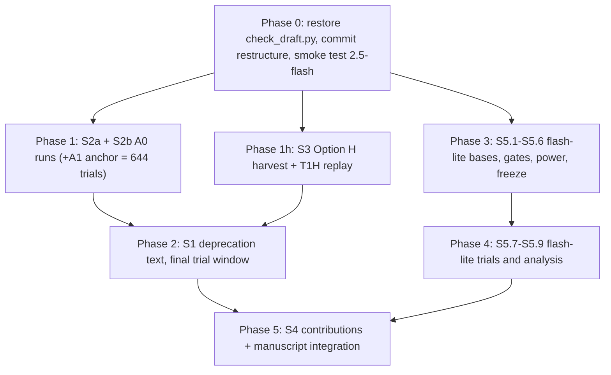

# Supervisor Feedback & Action Plan — 2026-11-13

**Status:** Recorded 2026-11-13, revised the same day (§12). **All open decisions (`Phase 0`, `I1`–`I7`) are locked in as of 2026-11-13** (`2.5-flash` shuts down 2026-12-01; S3 = **Option H** with 2×28 batch rule; S2 = **with in-session `A1` anchor** (`644` trials); `RUN_QUEUE.md` = **no cap**; Phase 0 = **restore `check_draft.py` and commit restructure first**; S5.0 verified **`gemini-3.5-flash-lite` is live** with `reasoning_effort=None`; S5 primary test = **two-sided exact McNemar at $\alpha = 0.05$**). Ready for execution.
**Next session: start at §11.**

> **Governance constraint (`PREREGISTRATION.md`).** Frozen 2026-09-14 at tag
> `prereg-freeze`. `cell="core"` (1,167 trials) is never altered. The RQ1
> confirmatory result (`A1 − A2` repair on `T2`, `+0.7 pp [−2.9, +4.3]`) stays
> the core's only confirmatory test. Every new pass below is a **new cell** with
> its own dated §0.1 amendment, committed before its first trial, and it pins
> its model ID in code so `.env` defaults cannot silently serve another model.
> Amendment numbers are assigned **in filing order**; the next free one is
> **A13** (A12 = thinking sweep). Below, A-S2 / A-S3 / A-S5 are placeholders
> until filed.

> **Urgency.** S2, and S3 if harvested, need `gemini-2.5-flash` to still be
> served. They are the only items that **cannot be done later**.

---

## 0. Supervisor feedback, verbatim

> Restructure lần này ok. Tuy nhiên, có 1 số cái cần làm trước khi Gemini 2.5-flash bị gỡ:
> 1. Viết deprecation vào §4.8 và §7: ngày nhận thông báo, khoảng thời gian chạy trial, và nêu rõ rằng exact re-execution không còn khả thi; trước đó cũng chỉ reproduce byte-for-byte được 76–83% across sessions.
> 2. Chạy A0 trên đủ 142 defect (213 trial), cộng A0 ở mức none và high trong sweep (270 trial). Thiếu phần sau, khoảng cách restoration +23.7 pp không có ceiling để đối chiếu.
> 3. Quyết định về real-defect bank. Hiện là 13 defect trong 7 cell. Hoặc là harvest ngay, hoặc giới hạn claim đúng mức 13 defect cho phép. Cả hai đều có thể chấp nhận được, nhưng phải chủ động lựa chọn một trong hai cách.
>
> Đoạn contributions: Khôi phục lại 2 hoặc 3 mục được đánh số. Nên nói thẳng phần dissociation giữa hai model: Gemini khác ở restoration chứ không ở repair, còn Qwen thì ngược lại.
> Experiment thì lấy pre-register exact restoration làm primary outcome, rồi replicate trên gemini-3.5-flash-lite với bases của chính nó. Cái này đưa phát hiện quan trọng nhất từ "discovered post hoc" thành "pre-registered và replicate trên model thứ hai", đồng thời giải quyết luôn vấn đề single-model và vấn đề model đã chết.

## 1. What the comment asks

| ID | Ask | Why | Needs 2.5-flash alive? |
|---|---|---|---|
| — | The restructure is approved | — | — |
| **S1** | Deprecation write-up in §4.8 (Execution) and §7 (Threats): notice date, trial window, exact re-execution no longer possible, cross-session byte reproduction was only 76–83% even before | Reproducibility must be stated where reviewers look for it, not only in §5/§6 | No (writing); the trial window is final only after S2 |
| **S2a** | `A0` on the 71 core defects that lack it: 71 × 3 = **213** trials | `A1/A0` today covers half the defects; the `A0` stride hit only 1 of the 5 `O1` p90 defects | **Yes** |
| **S2b** | `A0` at `none` and `high` in the thinking sweep: 45 × 2 × 3 = **270** trials | The `+23.7 pp` restoration gap (`A1` 80.7% vs `A2` 57.0% at `none`; also +23.7 at `low`) has nothing to compare against | **Yes** |
| **S3** | Real-defect bank (13 defects, 7 cells): **harvest now** or **limit the claims to what 13 defects allow**, chosen explicitly | Both acceptable; not deciding is not | **Yes — Option H chosen (2026-11-13)** |
| **S4** | Contributions: back to 2–3 numbered items, one stating the dissociation directly | Gemini differs on restoration, not repair; Qwen the reverse | No |
| **S5** | Pre-register exact restoration as the primary outcome, replicate on `gemini-3.5-flash-lite` with **its own bases** | Moves the main finding from "post hoc" to "pre-registered and replicated"; addresses single-model and dead-model criticisms | No (new model) |

The dissociation S4 asks for, as currently printed in `05-results.tex`:

| A1 − A2 | Repair | Exact restoration |
|---|---|---|
| Gemini 2.5 Flash (`T2`, N=139) | `+0.7 pp [−2.9, +4.3]`, p = 0.754 | **`+14.6 pp [+8.2, +21.3]`**, p = 0.0013 |
| Qwen2.5-7B (`T2L`, N=138) | **`+6.8 pp [+0.5, +13.3]`**, p = 0.052 (exploratory) | `+2.7 pp [−4.6, +9.9]`, p = 0.572 |

(`PREREGISTRATION.md` A12 quotes an older Qwen restoration figure, `+2.7 [−4.0, +9.5]`, p = 0.463. Use the `T2L/analysis.json` value; do not edit A12.)

## 2. Open inputs (author / supervisor)

| # | Input | Status / Decision | Blocks | Where it goes |
|---|---|---|---|---|
| **P0** | Phase 0 working-tree hygiene | ✅ **Decided 2026-11-13:** restore `docs/paper/journal/check_draft.py` (keep `CITATION_CHECK.md` and `RESOLVED_TODOS.md` deleted) and commit the approved restructure as its own commit before wiring new cells | Clean baseline commit before A-S2 | Phase 0 |
| **I1** | `gemini-2.5-flash` deprecation dates | ✅ **Decided 2026-11-13:** notice **2026-11-03**, shutdown **2026-12-01** *(still optional: save/paste notice URL or email for provenance)* | S1 text; deadline for S2 & S3 (18 days left) | §4.8, §7, §4 here |
| **I2** | **S3 decision: harvest (H) or limit claims (L)** | ✅ **Decided 2026-11-13:** **Option H (harvest now)** | S3 | `PREREGISTRATION.md` §0.1 (A-S3), §6 here |
| **I3** | In-session `A1` anchor for S2: yes (`+161` trials, ~`+2 M` tokens) / no | ✅ **Decided 2026-11-13:** **With anchor** (`+71` in `a0fill` → `284` trials; `+90` in `thinking_a0` → `360` trials; `644` total trials) | S2 amendment text | A-S2, §5 here |
| **I4** | Replication model ID + reasoning setting | ✅ **Verified 2026-11-13 (S5.0):** `gemini-3.5-flash-lite` is live on the endpoint and returns `model='gemini-3.5-flash-lite'`. Pin `reasoning_effort=None` (omitted, provider default, returns `reasoning=None`; note `reasoning_effort='none'` raises HTTP 400 `INVALID_ARGUMENT` on `gemini-3.5-flash-lite`) | S5 | A-S5, §8 here |
| **I5** | S5 primary test sidedness: one-sided (`A1 > A2` from core) or two-sided | ✅ **Decided 2026-11-13:** **Two-sided** ($\alpha = 0.05$ exact McNemar on per-defect majority exact restoration + two-sided 95% defect cluster-bootstrap CI; replicated iff $\text{A1} - \text{A2} > 0$, 95% CI excludes 0, and two-sided McNemar $p < 0.05$) | A-S5 freeze | A-S5, §8 here |
| **I6** | **Option H rules:** stopping rule, test vs descriptive, pooling | ✅ **Decided 2026-11-13:** draw 56 fresh businesses (`--per-stratum 21 --seed 20260803` minus original 28) in **two 28-business batches**; stop after Batch 1 if pooled `T1 + T1H` reaches **$\ge 18$ cells**, else run Batch 2 (hard cap: **56 new businesses**). Report `T1`, `T1H`, and **Pooled (`T1 + T1H`)** side-by-side (plus `A + H` single-pass sensitivity). Run formal two-sided cell-cluster bootstrap test on `A2 - A1` acceptance **iff pooled cells $\ge 15$** (else descriptive CIs only) | S3 amendment & launch | A-S3, §6 here |
| **I7** | **Budget ceiling raise** in `RUN_QUEUE.md` (was **75 M** / `$150`; `64.3 M` spent) | ✅ **Decided 2026-11-13:** **No cap** (remove/lift token & dollar ceiling guard in `RUN_QUEUE.md` so S2, Option H, and S5 are uncapped; still log exact token counts per cell) | Launching S2+H and S5 | `RUN_QUEUE.md` Rule 6 |

## 3. Order of work



Phase 1 and Phase 1h (S2 `A0` runs + S3 Option H harvest) go first because both depend on `gemini-2.5-flash`, which shuts down on **2026-12-01** (run S2 before H if API quota/time gets tight, since S2 takes ~6.7–7.8 M tokens and protects the core/sweep ceilings). Phase 3 runs on another model and can proceed in parallel; its Phase-A bases are cheap (§8).

**Phase 0 — repo hygiene (decided 2026-11-13; execute first when go-ahead is given).**
1. Restore `docs/paper/journal/check_draft.py` from `HEAD` (`git checkout HEAD -- docs/paper/journal/check_draft.py`); leave `docs/paper/journal/CITATION_CHECK.md` and `docs/paper/journal/RESOLVED_TODOS.md` deleted.
2. Stage and commit the approved restructure as its own clean commit **before** wiring new cells (`a0fill`, `thinking_a0`, `flashlite`) or filing A-S2.

Engineering rules for every new pass (as for the existing cells):

1. New cell in `CELLS` / `CELL_OUT` of `backend/scripts/run_injection_study.py`; core's plan stays byte-identical (pinned by `tests/test_run_injection_study.py`); `T2T` plan stays 1,224.
2. Model ID pinned in code for the cell (`agent._model` / `agent._fallback_model` inside `_regenerate`, plus `OPENAI_MODEL` and `OPENAI_FALLBACK_MODEL` — note `llm_config.py` reads `OPENAI_MODEL`, not `LLM_PRIMARY_MODEL`); `LLM_DISABLE_FALLBACK=1`; the verification gate checks every trial row's `served_models`.
3. `--plan-only` → `--dry-run` → 1-call live smoke → amendment committed → live run.
4. Verification gate: complete checkpoint, one session per defect, offline re-score agrees with live score on every trial.
5. Analysis through `backend/scripts/analysis/repair_analysis.py --cell <name>`; numbers flow `analysis.json` → `RESULTS.md` → `.tex`.
6. Token accounting in `docs/paper/RUN_QUEUE.md`: **no cap** (decided 2026-11-13, I7); update `RUN_QUEUE.md` Rule 6 to remove the 75 M / `$150` ceiling while continuing to log exact pre-run estimates and post-run actuals per cell.
7. No commit, tag or push without the author's go-ahead (AGENTS.md).

---

## 4. S1 — Deprecation write-up (§4.8, §7)

**Inputs:** I1; the trial window; the test–retest figures already in §5
(`05-results.tex` ≈ L266: "76.4–83.3% of pairs"; C1 cell: 213 of 222 pairs kept their class, 185 (83%) byte-identical).

**Steps**

1. **Trial window.** Trial rows carry **no timestamps** (row keys: `defect_id … served_models, total_tokens …`). Assemble the window from:
   Phase-A `started_at` in `out_study/A/checkpoint.jsonl` (2026-08-03 → 2026-08-26; B and R ran 2026-08-03);
   dated entries in `RUN_QUEUE.md` (core interim look 2026-10-05; Q1 2026-10-07; Q3 2026-10-08; Q7 2026-11-02);
   `PREREGISTRATION.md` §10; git commit dates of each cell's `checkpoint.jsonl`.
   `served_models` is already verified as `['gemini-2.5-flash']` across `T1`, `T2`, `T2C1`, `T2D19`, `T2D`, `T2P`, `T2S`, `T2T`, `T2W`, and the last 8 rows of `A` (2026-08-26); earlier `A` (pre-08-24), `B`, and `R` rows lack `served_models` because logging was added on 2026-08-24 (`run_study.py` L321). Tabulate one row per dir, then extend with S2's run dates.
2. **§4.8, new paragraph "Model availability"** after "One session per defect". Draft (`\ref{sec:results-rq2}` is verified as the subsection containing "Serving drift", `05-results.tex` L261):

   > All hosted-model trials ran on `gemini-2.5-flash` between ⟨first date⟩ and
   > ⟨last date⟩. On 3~November~2026 the provider announced that the model would be
   > withdrawn on 1~December~2026. Exact re-execution of this study is therefore no
   > longer possible. It was not fully possible before the withdrawal either: in the
   > cells that re-ran a core condition in a later session, outputs were
   > byte-identical in only 76.4–83.3% of pairs (Section~\ref{sec:results-rq2}).
   > What remains possible is re-analysis. Every trial's prompt, output, token count
   > and serving model are committed, and every number in Section~\ref{sec:results}
   > is regenerated from those records with no model calls. The pre-registered
   > replication in Section~⟨S5⟩ runs on a model that is still served.
3. **§7, new "Reproducibility" paragraph** (head of Internal validity or External validity). Draft:

   > The hosted model was withdrawn on 1~December~2026 (announced 3~November~2026),
   > so no reader can re-run these trials.
   > Before the withdrawal, cross-session reproduction was already partial (76–83%
   > byte-identical pairs), which is why every contrast is matched within one session
   > and no cell borrows another's comparators. The committed records allow full
   > re-analysis, not re-execution. The replication on ⟨model⟩ (Section~⟨S5⟩) is the
   > study's reproducible counterpart.

   If S2 is reported cross-session (§5.3 option a), this paragraph must also say that the S2 `A0` trials are the one exception to within-session matching.
4. **`declarations.tex` → data availability:** one sentence distinguishing re-analysis (possible: scripts + records) from re-execution (impossible after 1~December~2026).
5. Keep §5/§6's existing 76–83% sentences; §4.8/§7 cite them, they do not repeat the analysis.

**Done when:** trial-window table complete including S2 and S3 harvest (`T1H`); notice URL/source archived if available; §4.8, §7 and declarations carry the text; `latexmk` builds clean.

---

## 5. S2 — Complete the `A0` ceiling (amendment A-S2)

### 5.1 S2a — `A0` on the other 71 core defects + `A1` anchor (cell `a0fill` → `out_study/T2A0`)

- **Selection:** every core defect for which `_in_subset(op_index, ARM_FRACTION["A0"]=0.5)` is false. The stride is **per operator** (`op_index[op]`), with the core's `build_plan` order, D20 gates and seed. Core ran `A0` on 71 defects (213 trials, 209 usable), so the complement should be 71. `--plan-only` must report **284** trials (`71 × 3 = 213` `A0@P1` + `71 × 1 = 71` `A1@P1` anchor per **I3**); if not, stop and reconcile before filing.
- **Cells:** `A0@P1` (`r = 3`) and `A1@P1` (`r = 1` anchor), `C0`, `gemini-2.5-flash` pinned, default reasoning (as the core), one session per defect.
- **Readouts fixed before running:**
  1. `A1/A0` repair ratio over all 142 defects (plus the in-session `A1/A0` on the 71 `a0fill` defects and the drift comparison between the `r = 1` anchor `A1` and the core's `A1`), next to the existing in-session 71-defect ratio (`0.96 [0.92, 1.00]`).
  2. `A0` repair and `A0` exact restoration by operator and by review-count stratum, with all 5 `O1` p90 defects now covered.
  3. `A0` exact restoration over 142 defects, and `A1`, `A2` restoration beside it (see the caveat in 5.2).
- **Analysis code:** `repair_analysis.py` computes `A1/A0` within the core cell; it must be extended to join `T2` (A1/A2) with `T2A0` (A0 + anchor A1) on `defect_id`, reporting both the pooled 142-defect `A1/A0` and the within-`T2A0` anchor check.

### 5.2 S2b — `A0` at `none` and `high` in the sweep + `A1` anchor (cell `thinking_a0` → `out_study/T2TA0`)

- **Selection:** the same 45 defects as `T2T` (placement 1/3 per-operator stride). `T2T` itself is not modified.
- **Cells:** `A0@P1` (`r = 3`) and `A1@P1` (`r = 1` anchor per **I3**) at efforts `none` and `high` → `45 × 2 × (3 + 1) =` **360** trials (`270` `A0` + `90` `A1` anchor). The runner sets `agent.reasoning_effort = cell.get("reasoning_effort")` for every arm (≈ L777); confirm in `--dry-run` that the `A0` message path carries it.
- **Readouts fixed before running:**
  1. `A0` exact restoration at `none` and `high` (defect-level means, cluster-bootstrap CI over defects), plus within-session `A1 − A0` on the anchor vs cross-session `A1 − A0` against `T2T`.
  2. Differences `A0 − A1` and `A0 − A2` in exact restoration at each level, with bootstrap CIs. The ratio `(A1 − A2)/(A0 − A2)` ("share of the gap closed") is reported **only if** the CI of `A0 − A2` excludes 0; otherwise it is unstable and omitted.
  3. `A0` repair at both levels (expected near 100%; reported, not tested).
- **Caveat to pre-register (important):** `A0` is a **repair** ceiling by design; it is **not guaranteed to be a restoration ceiling**. In the core, `A0` restored 71.3% of trials against `A1`'s 68.4%, nearly equal; in the sweep `A1` already restores 80.7% at `none`. If `A1 ≥ A0` in restoration, the pre-registered reading is: "measured facts restore at least as often as a direct correction request", and the +23.7 pp is read as `A2` falling below the correction-task level, not as `A1` approaching a ceiling. Fix both readings in the amendment before the data exist.
- **Analysis code:** `repair_analysis.py` L579 (`THINKING_LEVELS`) omits `A0`, and `analyse_thinking` reads one checkpoint; extend `repair_analysis.py` with `--cell a0fill` (joining `T2` + `T2A0` on `defect_id`) and `--cell thinking_a0` (joining `T2T` + `T2TA0` on `defect_id`).
- **Why only `none` and `high`:** the ends of the sweep; `low`/`medium` are not asked for and would cost 270 more.

### 5.3 Session caveat (I3 = **Option b chosen 2026-11-13: In-session `A1` anchor**)

The new `A0` trials run in a later session than the `A1`/`A2` in `T2` and `T2T`. Per **I3** (decided 2026-11-13), we include the **in-session `A1` anchor** (`(b)`):
- `A1@P1` `r = 1` on each S2a defect (`71` trials in `a0fill` → `284` total) and `A1@P1` `r = 1` at `none` and `high` on each S2b defect (`90` trials in `thinking_a0` → `360` total).
- This measures cross-session drift on `A1` directly (byte-identity and restoration rate of anchor `A1` vs original `T2`/`T2T` `A1`) and provides a strictly within-session `A1` vs `A0` comparison alongside the joined 3-rep comparison (`+161` trials, ≈ `+2 M` tokens, `644` trials total across S2a + S2b).

### 5.4 Steps

1. Live 1-call smoke on `gemini-2.5-flash` **first** (2.5-flash-lite was already refused to "new users" on 2026-11-01; 2.5-flash may be similarly restricted). Check `served_models`.
2. Wire `a0fill` and `thinking_a0` (new cell builders; `REQUIRED_ARMS` entries for `{"A0", "A1"}`).
3. Tests: plan counts **284** (`213 A0 + 71 A1`) and **360** (`270 A0 + 90 A1`); core 1,167 and `T2T` 1,224 unchanged.
4. `--plan-only`, `--dry-run`.
5. Tokens: S2a ≈ `213 × 11.8 k + 71 × 11.8 k` ≈ `3.3 M`; S2b ≈ `270 × 8–12 k + 90 × 8–12 k` ≈ `2.9–4.3 M`. Total ≈ **6.2–7.6 M tokens** across `644` trials (uncapped per I7).
6. File the amendment in `PREREGISTRATION.md` §0.1 (design, readouts, caveat 5.2, in-session anchor 5.3); add queue items to `RUN_QUEUE.md`; commit with the author's go-ahead.
7. Run `--cell a0fill`, then `--cell thinking_a0`. Verification gate.
8. Analysis, `RESULTS.md`.
9. Manuscript: `tab:cells` (two rows), `tab:amendments`, §5 RQ1 `A1/A0` sentence and table row, `tab:thinking` gains `A0` at `none`/`high`, §5.8 text reads `+23.7 pp` against `A0`, appendix decomposition `A0` column over 142.

**Done when:** 284 + 360 = **644** trials usable and verified, readouts in `analysis.json`, paper updated, trial window in §4 extended.

---

## 6. S3 — Real-defect bank decision (I2 = **Option H chosen 2026-11-13**)

> **Decision recorded (2026-11-13):** **Option H — harvest now** before the
> `2026-12-01` shutdown. Option L below is superseded unless harvest fails.

Current bank: 13 usable defects in 7 business × stage cells across 6 businesses, most of them one class (`8` `untraceable_recommendation`, `3` `missing_evidence_id`, `2` `misaligned_aspect`). They came from **53 observe-mode runs** (`6` from the 28 Phase-A runs in `out_study/A`, `7` from the 25 repetition runs in `out_study/R`), so a single-pass harvest yields ≈ **0.21 defects and ≈ 0.21 cells per business**.

### Option H — harvest now (amendment A-S3) **[CHOSEN]**

1. Draw fresh businesses: `sample_businesses.py` has **no `--exclude` flag**, so draw with `--per-stratum 21 --seed 20260803` (prefix-stable superset of the original 7/stratum = 28 businesses) and drop the 28 IDs already in `out_study/sample.json`, yielding **56 fresh businesses** (14 per stratum, split into **Batch 1 = 28** and **Batch 2 = 28**). Keep `MAX_REVIEW_SAMPLE=500` so `p90` (214 reviews) is not truncated.
2. Phase A (observe) on `gemini-2.5-flash` (`OPENAI_MODEL` pinned, `LLM_DISABLE_FALLBACK=1`) into a **separate root** (e.g. `out_study/H/A`) so the Tier-2 injection bases (`out_study/A`) are untouched.
3. `analysis/defect_bank.py --root out_study/H` over the new dumps; replay gate (`measure`/`decide` must reproduce the recorded retry).
4. `run_tier1_replay.py --root out_study/H --out out_study/T1H` (pin `OPENAI_MODEL` and `LLM_DISABLE_FALLBACK=1`, as `run_tier1_replay.py` uses `llm_config`); `A1`, `A2`, `A3` at `P0`, r = 3 (9 trials per defect).
5. **Pre-registered parameters for A-S3 (decided 2026-11-13, I6):**
   - **Stopping rule:** Run Phase A + `defect_bank.py` on **Batch 1 (28 fresh businesses)** first; if the **pooled bank (`T1 + T1H`) reaches $\ge 18$ distinct `business × stage` cells** after Batch 1, stop harvesting and run `T1H` replay; otherwise run **Batch 2 (28 fresh businesses, hard cap = 56 new businesses total)** and stop there regardless of yield. Stopping checks only cell count before any `T1H` replay trial runs—never outcomes.
   - **Pooling & test rule:** Report **`T1` (13 defects / 7 cells)**, **`T1H` (fresh harvest)**, and **Pooled (`T1 + T1H`)** side-by-side in the primary RQ3 table, plus a **single-pass Phase-A sensitivity (`A + H`, excluding `R`'s 5-rep businesses)**. Always report cell-cluster bootstrap 95% CIs on acceptance (`A2 − A1`, `A1 − A3`) and clean-check pass rate; run a formal two-sided cell-cluster bootstrap test on `A2 − A1` acceptance **if and only if** the pooled bank reaches **$\ge 15$ distinct `business × stage` cells** (if $< 15$ cells, report CIs descriptively without a $p$-value, citing the small-cluster Type I error inflation in §4.7).
6. Cost: Phase A averaged 41 k tokens per business (`1.16 M` for 28; `~2.3 M` for 56). At the Phase-A yield (`~0.21` cells/business), 56 new businesses yield ~11–12 new cells (~18–19 total cells when pooled with `T1`'s 7 cells). Replaying each defect (`P0`, 9 trials) used `~318 k`/defect in `T1` (`4.13 M` for 13 defects), so replaying ~12 new defects adds `~3.8 M` tokens → **~6.1 M tokens total** (uncapped per I7).
7. Limit: a bigger bank still reflects what `gemini-2.5-flash` gets wrong (`9/11` audited defects in the existing bank were checker false positives, mostly paraphrases), so harvest raises `N` without fixing class coverage or precision.

### Option L — limit the claims to 13 defects *(superseded 2026-11-13 by Option H; fallback only)*

Edits (located with grep for "real defect", "13", "seven cells"; line numbers as of 2026-11-13):

| File | Change |
|---|---|
| `05-results.tex` L274 heading | "Real defects are not injected defects" → descriptive, e.g. "RQ3: The production retry on 13 real defects (descriptive)" |
| `05-results.tex` L279–333 | Keep rates with cluster-bootstrap intervals over 7 cells; state no test is run; the `A2` vs `A1` acceptance gap (76.9% vs 28.2%) is "observed in this bank", not a property of real defects |
| `00-abstract.tex` L15, `01-introduction.tex` L62/L73, `08-conclusion.tex` L12, `highlights.txt` L10 | Replace general real-vs-injected comparisons with "in 13 replayed real defects, …" |
| `04-design.tex` RQ3 statement, L205, L431 | RQ3 restated as a descriptive case series |
| `06-discussion.tex` L34/L38/L81 | Remove inference beyond the bank |
| `07-threats.tex` L28/L77/L91 | One sentence: 13 defects in 7 cells, mostly one class, support descriptive reporting only |
| `02-related-work.tex` L153, `03-system.tex` L136 | Check wording only |

### Option L+ (compatible with L)

S5's Phase A on the replication model (§8, S5.2) yields that model's own real defects at no extra Phase-A cost. Replaying them (`T1FL`) adds second-model real-defect evidence; it does not enlarge the 2.5-flash bank.

### Recommendation (author decides)

**L, plus L+ if S5 runs.** Harvesting competes with S2 for 2.5-flash's last days and would not fix the one-class problem. Choose **H** if the shutdown date leaves comfortable time after S2 and the paper is meant to make a general real-vs-injected claim. Record choice, date and reason in `PREREGISTRATION.md` §0.1 and in §10 here.

**Done when:** I2 recorded; either `T1H` verified and integrated, or every row of the L table applied.

---

## 7. S4 — Contributions paragraph (numbered, 3 items)

Replace the one-sentence list in `01-introduction.tex` (≈ L76–80). Draft **before** S5 (macros `\ci`, `\pp` exist in `macros.tex`):

```latex
The contributions are three.
\begin{enumerate}
\item A pre-registered, gated fault-injection protocol for a runtime-supervised
  LLM pipeline, with a paired comparison of feedback content bounded by a
  capability ceiling and a regeneration baseline, and trial records that allow
  every result to be re-analysed without model calls.
\item A dissociation between two models in what measured-fact feedback changes.
  On Gemini~2.5~Flash, which repairs at its ceiling, measured facts left repair
  unchanged (+0.7\pp{} \ci{-2.9}{+4.3}) but raised exact restoration of the clean
  output (+14.6\pp{} \ci{+8.2}{+21.3}). On Qwen2.5-7B, below its ceiling, the
  pattern reversed: repair rose (+6.8\pp{} \ci{+0.5}{+13.3}, exploratory) and
  restoration did not (+2.7\pp{} \ci{-4.6}{+9.9}).
\item Evidence on the limits of stage-local verification: a replay of real
  defects caught in production, downstream propagation of every injected defect,
  calibration of the supervisor's checks, and the cost of deterministic overwrite.
\end{enumerate}
```

Honesty constraints: the Gemini restoration contrast is post hoc until S5; the Qwen repair contrast is exploratory (p = 0.052). Do not write "double dissociation" as a tested claim; there is no interaction test.

After S5, item 2 gains one sentence written to the result whichever way it goes:
"The restoration effect, pre-registered as the primary outcome, ⟨replicated / did not replicate⟩ on ⟨model⟩ run on its own bases (⟨estimate, CI, p⟩)."
If S3 = L, item 3 says "a descriptive replay of 13 real defects".

Align the abstract, `highlights.txt` and §8 with the same wording.

**Done when:** numbered list in place, numbers match `T2/analysis.json` and `T2L/analysis.json`, abstract ≤ 250 words, highlights ≤ 85 chars, `latexmk` clean.

---

## 8. S5 — Pre-registered replication on `gemini-3.5-flash-lite` (amendment A-S5, cell `flashlite` → `out_study/T2FL`)

**Goal:** one confirmatory test, fixed before any trial: measured facts (`A1`) raise unconditional exact restoration over generic rejection (`A2`) on a second model, with defects injected into that model's own clean outputs.

**S5.0 Availability (verified 2026-11-13).** `models.list()` on `https://generativelanguage.googleapis.com/v1beta/openai/` confirmed `models/gemini-3.5-flash-lite` is live. 1-call smoke test on `gemini-3.5-flash-lite` at `temperature=0`:
- `reasoning_effort=None` (omitted, provider default) succeeded and returned `model='gemini-3.5-flash-lite'`, `reasoning_tokens=None`, `total_tokens = prompt_tokens + completion_tokens`.
- `reasoning_effort='none'` failed with HTTP 400 (`INVALID_ARGUMENT: Request contains an invalid argument`).
- `reasoning_effort='low'` succeeded (`model='gemini-3.5-flash-lite'`, `reasoning_tokens=None`).
- **Rule:** Pin `REPLICATION_MODEL = "gemini-3.5-flash-lite"` and keep `reasoning_effort=None` (omitted, matching the core).

**S5.1 Pin.** `REPLICATION_MODEL = "gemini-3.5-flash-lite"` for **both** Phase A (`run_study.py`) and trials (`run_injection_study.py`), with `LLM_DISABLE_FALLBACK=1` and `reasoning_effort=None`. Because `run_study.py` calls `load_dotenv()` and `llm_config.py` reads `OPENAI_MODEL` / `OPENAI_FALLBACK_MODEL` (NOT `LLM_PRIMARY_MODEL`), add a `--model` override after `load_dotenv()` (or set `OPENAI_MODEL` and `OPENAI_FALLBACK_MODEL` in code) and verify `served_models == ["gemini-3.5-flash-lite"]` in both `FL/A/checkpoint.jsonl` and `T2FL/checkpoint.jsonl`. Note: the 2026-11-01 `--cell flashlite` wiring was **never committed** (`git log -S FLASHLITE_MODEL --all` is empty; no stash) — write it fresh.

**S5.2 Own bases.** Phase A (observe) on **the same 28 businesses** (`out_study/sample.json`, `MAX_REVIEW_SAMPLE=500` and `RANDOM_SEED=42`, matching `out_study/A` which loaded 14/34/92/214 reviews per stratum) into `out_study/FL/A`. Do **not** pass `--sample-size 100` (`run_study.py` refuses when `214 > cap`, or `--allow-cap` would collapse `p90`). ≈ 28 × 41 k ≈ 1.2 M tokens (model-dependent). Also yields this model's incidence figures and real-defect bank (`run_tier1_replay.py --root out_study/FL --out out_study/T1FL` for S3 L+).

**S5.3 Gates and N.** `run_injection_study.py --root out_study/FL --cell flashlite --plan-only`. The D20 gates (applicable, injection validity, trigger) cost nothing and give `N_FL`; record each denominator. `N_FL` will differ from 142.

**S5.4 Determinism.** Measure, don't gate: 10 real prompts sent twice (as C7's G2), reported. r = 3 regardless (A11 precedent).

**S5.5 Power.** Extend `scripts/analysis/power.py` (which currently hardcodes repair rates 0.45 vs 0.33 and runs pair-level McNemar + two-sided bootstrap) to simulate **two-sided defect-majority exact McNemar** (per I5) and two-sided cluster bootstrap at `N_FL`, r = 3, for exact restoration (simulating from the core's rates ~0.68 vs ~0.53 and a half-size effect). Record the MDE in A-S5. If MDE > ≈ 15 pp, decide before freezing whether to add bases (more businesses via `sample_businesses.py --per-stratum N --seed 20260803`); reps do not buy power here.

**S5.6 Freeze A-S5** (committed and tagged, e.g. `prereg-fl-freeze`, before the first trial):

- *Model, bases, runtime:* S5.0–S5.2 values (`gemini-3.5-flash-lite`, `reasoning_effort=None`); temperature 0; one session per defect; defect-outer loop.
- *Arms:* `A0`, `A1`, `A2` at `P1` on all `N_FL` defects; `A3` at `P0` on the quarter stride; r = 3 (full `A0`, as the 2026-10-31 feedback required).
- *Primary outcome:* exact restoration = canonical-JSON identity (sorted keys, invariant whitespace) of the retried stage output to the model's own clean pre-injection output; unconditional over all trials.
- *Unit and test:* defect-level majority over r = 3; `A1` vs `A2` by **two-sided exact McNemar** on discordant defects at α = 0.05 (per I5); two-sided defect cluster-bootstrap 95% CI. Losses as prereg §2.4.
- *Replication criterion, stated in advance:* replicated iff point estimate $\text{A1} - \text{A2} > 0$, the two-sided 95% defect cluster-bootstrap CI excludes 0, and two-sided exact McNemar $p < 0.05$; otherwise "not replicated", with the estimate.
- *Secondary (exploratory):* `A1 − A2` repair; `A1/A0` repair and restoration; 3- and 4-way decomposition; by operator (`O1`, `O2`, `O3` never pooled; `O5–O7` flat controls); by review-count stratum.
- *Dissociation readout with a recorded prediction:* restoration-type (like Gemini 2.5 Flash), repair-type (like Qwen), or both, predicted from where its `A0` repair ceiling lands.
- *Analysis code:* written and tested on synthetic rows **before** the freeze; hash recorded.
- *Multiplicity:* own single confirmatory test; the core's RQ1 test unchanged.

**S5.7 Wire and test.** `CELLS` / `CELL_OUT`; tests pin plan count; core 1,167 unchanged.

**S5.8 Budget.** ≈ (`N_FL` × 9 + A3 quarter × 3) × ~14 k ≈ 18–20 M + 1.2 M Phase A (uncapped per I7; log exact estimate and actuals in `RUN_QUEUE.md`).

**S5.9 Run → verify → analyse.** Gate; `repair_analysis.py --cell flashlite`; `RESULTS.md`.

**S5.10 Manuscript.** §4: new subsection for the pre-registered replication, confirmatory for its own test. §5: RQ2 leads with the replication result, then the core's post-hoc estimate; RQ6 adds the third model. §7: rewrite "discovered post hoc" and "one model" sentences to the result; model and bases change together, so a non-replication cannot be attributed to either alone. Abstract, highlights, contributions item 2.

**Done when:** A-S5 committed before the first trial; all trials verified; the confirmatory result reported as pre-registered, whatever its direction.

---

## 9. Manuscript change map

| File | S1 | S2 | S3 | S4 | S5 |
|---|---|---|---|---|---|
| `00-abstract.tex` | | | L/H | ✓ | ✓ |
| `01-introduction.tex` | | | L/H | ✓ | ✓ |
| `04-design.tex` | §4.8 | `tab:cells`, `tab:amendments` | RQ3 | | new subsection |
| `05-results.tex` | | RQ1, §5.8 `tab:thinking` | RQ3 | | RQ2, RQ6 |
| `06-discussion.tex` | | §5.8 reading | L/H | | ✓ |
| `07-threats.tex` | ✓ | (if cross-session) | ✓ | | ✓ |
| `08-conclusion.tex` | | | L/H | ✓ | ✓ |
| `appendix-amendments.tex` | | A-S2 | A-S3 (H) | | A-S5 |
| `appendix-diagnostics.tex` | | `A0` columns | | | third model |
| `declarations.tex` | ✓ | | | | |
| `highlights.txt` | | | L/H | ✓ | ✓ |
| `RESULTS.md`, `RUN_QUEUE.md`, `NEXT_SESSION.md` | | ✓ | ✓ | | ✓ |

## 10. Checklist and decision log

- [x] **Phase 0 decision recorded (2026-11-13):** restore `docs/paper/journal/check_draft.py` (keep `CITATION_CHECK.md` and `RESOLVED_TODOS.md` deleted) and commit the approved restructure as its own commit before wiring new cells *(execution pending author go-ahead)*
- [x] **I1 notice and shutdown dates recorded (2026-11-13):** notice `2026-11-03`, shutdown `2026-12-01` *(notice URL/email optional)*
- [x] **I2 S3 decision (2026-11-13):** **Option H (harvest now)** before `2026-12-01` shutdown
- [x] **I3 S2 anchor recorded (2026-11-13):** **With in-session `A1` anchor** (`+161` trials → `284` in `a0fill` + `360` in `thinking_a0` = `644` total trials)
- [x] **I4 S5.0 model verified (2026-11-13):** `gemini-3.5-flash-lite` is live and returns `model='gemini-3.5-flash-lite'` (`reasoning_effort=None`; `reasoning_effort='none'` is rejected with HTTP 400)
- [x] **I5 S5 primary test sidedness recorded (2026-11-13):** **Two-sided** ($\alpha = 0.05$ exact McNemar on per-defect majority exact restoration + two-sided 95% defect cluster-bootstrap CI; replicated iff $\text{A1} - \text{A2} > 0$, 95% CI excludes 0, and two-sided McNemar $p < 0.05$)
- [x] **I6 Option H rules recorded (2026-11-13):** 56 fresh businesses (`--per-stratum 21 --seed 20260803` minus original 28) in two 28-business batches; stop after Batch 1 if pooled `T1 + T1H` reaches $\ge 18$ cells, else run Batch 2 (hard cap 56); report `T1`, `T1H`, `Pooled (T1 + T1H)`, and `A + H` single-pass sensitivity; run formal two-sided cell-cluster bootstrap test on `A2 - A1` acceptance iff pooled cells $\ge 15$
- [x] **I7 `RUN_QUEUE.md` token/dollar ceiling (2026-11-13):** **No cap** (remove/lift the 75 M / `$150` ceiling; continue logging exact token counts per cell)
- [ ] Phase 0 executed (`check_draft.py` restored, restructure committed)
- [ ] 2.5-flash smoke passed
- [ ] A-S2 filed (number ⟨ ⟩) and committed; S2a 284 + S2b 360 (`644` total) verified
- [ ] A-S3 filed (number ⟨ ⟩) and committed; Option H harvest + `T1H` replay verified
- [ ] S1 text in §4.8, §7, declarations
- [ ] S5 bases built (`out_study/FL/A`); `N_FL` and MDE known
- [ ] A-S5 frozen and tagged before first replication trial
- [ ] S5 trials verified and analysed
- [ ] S4 contributions, abstract, highlights aligned
- [ ] `latexmk` clean; draft checks pass (`check_draft.py`)

---

## 11. Next-session prompt (paste into a new chat)

```text
Context: COS30018 repo, research paper in docs/paper/journal/ (JSS draft).
The supervisor approved the restructure and left new requests on 2026-11-13.
Read, in order:
  1. docs/paper/SUPERVISOR_FEEDBACK_2026-11-13.md  (feedback verbatim + full plan; §2 & §10 = all locked decisions)
  2. AGENTS.md and CLAUDE.md (working rules & environment traps)
  3. docs/paper/PREREGISTRATION.md §0.1 (amendments A1–A12; next free = A13)
  4. backend/scripts/run_injection_study.py (CELLS, _cells_for, _thinking_cells, build_plan, _regenerate)

Path & shell rules: the workspace path contains "Tài liệu" (NFD). Use the 8.3
short path C:\Users\hoanh\OneDrive\TAILIU~1\CSMATE~1\COS30018\Project\COS300~1.1_M
for file tools and verify writes with `git status --short`. Run backend
commands from backend/ using backend/venv/Scripts/python.exe.

Hard rules:
- Never alter cell="core" (1,167 trials) or T2T (1,224).
- Every new pass is a new cell with a dated §0.1 amendment committed before its
  first trial; pin agent._model / agent._fallback_model AND OPENAI_MODEL /
  OPENAI_FALLBACK_MODEL (note llm_config.py reads OPENAI_MODEL, not
  LLM_PRIMARY_MODEL) with LLM_DISABLE_FALLBACK=1.
- Never truncate p90 bases (MAX_REVIEW_SAMPLE=500, matching out_study/A's 214 reviews).
- No commit, tag or push without my go-ahead.

All decisions are locked in (§2 of docs/paper/SUPERVISOR_FEEDBACK_2026-11-13.md):
  Phase 0: restore docs/paper/journal/check_draft.py (keep CITATION_CHECK.md and RESOLVED_TODOS.md deleted) and commit the approved restructure as its own clean commit before wiring new cells
  I1 deprecation dates: notice 2026-11-03; shutdown 2026-12-01
  I2 real-defect bank (S3): Option H (harvest now before 2026-12-01)
  I3 S2 A0 runs: With in-session A1 anchor (+161 trials -> 284 in a0fill + 360 in thinking_a0 = 644 total trials)
  I4 replication model (S5.0 verified): gemini-3.5-flash-lite with reasoning_effort=None (do NOT pass reasoning_effort='none', which returns HTTP 400)
  I5 replication primary test (S5): Two-sided exact McNemar at alpha=0.05 on per-defect majority exact restoration + two-sided 95% defect cluster-bootstrap CI (replicated iff A1 - A2 > 0, 95% CI excludes 0, and two-sided McNemar p < 0.05)
  I6 Option H rules: 56 fresh businesses (--per-stratum 21 --seed 20260803 minus original 28) in two 28-business batches; stop after Batch 1 if pooled T1+T1H >= 18 cells, else run Batch 2 (cap 56); report T1, T1H, Pooled (T1+T1H), and A+H single-pass sensitivity; run formal two-sided cell-cluster bootstrap test on A2-A1 acceptance iff pooled cells >= 15
  I7 budget guard in RUN_QUEUE.md: No cap (remove the 75M / $150 cap; log exact token estimates and actuals per cell)

Task for this session:
  1. Execute Phase 0: restore docs/paper/journal/check_draft.py, lift the 75M/$150 cap in docs/paper/RUN_QUEUE.md, show `git status --short`, and ask for my go-ahead to commit the restructure baseline.
  2. Prepare Phase 1 (S2) & Phase 1h (S3 Option H): run a 1-call smoke test on gemini-2.5-flash, wire cells `a0fill` (284 trials: 213 A0 + 71 A1 anchor) and `thinking_a0` (360 trials: 270 A0 + 90 A1 anchor) in `run_injection_study.py` + `repair_analysis.py` with unit tests, run `--plan-only` and `--dry-run`, generate the Option H 56-business list (Batch 1 = 28, Batch 2 = 28), and draft the §0.1 amendments for S2 and S3.
  3. Stop and report exact plan counts, test results, and amendment drafts for my approval before committing the amendments or launching the live `gemini-2.5-flash` runs.
```

---

## 12. Revision log

**2026-11-13 (decision update 4 — all decisions locked).** Recorded I5 (**two-sided exact McNemar at $\alpha = 0.05$** + two-sided 95% defect cluster-bootstrap CI; replicated iff $\text{A1} - \text{A2} > 0$, 95% CI excludes 0, and two-sided McNemar $p < 0.05$). All open inputs (`Phase 0`, `I1`–`I7`) are now decided and locked in §2, §8, §10, and §11.

**2026-11-13 (decision update 3 + S5.0 model check).** Recorded I6 (Option H 2×28 batch rule, $\ge 18$ cells early stop, $\ge 15$ cells test gate, side-by-side + pooled + single-pass reporting) and I4 (`S5.0` live check: `gemini-3.5-flash-lite` is live and returns `model='gemini-3.5-flash-lite'` with `reasoning_effort=None`, whereas `reasoning_effort='none'` returns HTTP 400 `INVALID_ARGUMENT`).

**2026-11-13 (decision update 2).** Recorded Phase 0 (**restore `check_draft.py` and commit restructure first**), I3 (**with in-session `A1` anchor**, `284 + 360 = 644` trials across `a0fill` and `thinking_a0`), and I7 (**no cap** in `RUN_QUEUE.md`); updated §2, §3, §5, §8, §10, and §11 prompt.

**2026-11-13 (decision update 1).** Recorded I1 (`2026-11-03` notice, `2026-12-01` shutdown) and I2 (**Option H — harvest now**); added I6 (Option H stopping rule & pooling/test scope) and I7 (token ceiling raise above 75 M); updated §4 draft dates, §6, §10, and §11 prompt.

**2026-11-13 (same-day audits).** Corrections applied after verifying against the repo:

1. `A0` is a repair ceiling, not necessarily a restoration ceiling (core: `A0` 71.3% vs `A1` 68.4% restoration; sweep `A1` already 80.7% at `none`). Added the pre-registered reading for `A1 ≥ A0` and made `(A1 − A2)/(A0 − A2)` conditional on `A0 − A2` excluding 0 (§5.2).
2. Amendment numbers assigned in filing order (placeholders A-S2/A-S3/A-S5) instead of fixed A13/A14/A15.
3. Added Phase 0: restructure is uncommitted; `CITATION_CHECK.md`, `RESOLVED_TODOS.md`, and `check_draft.py` are deleted in the working tree; 2026-10-30 feedback file untracked.
4. Confirmed `flashlite` wiring was never committed (`git log -S` empty), so S5 wires it fresh.
5. Confirmed `S2a` complement is exactly 71 defects (213 trials) and `T2T` has 45 defects / 12 `A3` defects (1,224 trials); noted `repair_analysis.py` needs `--cell a0fill` and `--cell thinking_a0` cross-session joins (`THINKING_LEVELS` currently omits `A0`).
6. Verified `S1` trial-window `served_models` across checkpoints, confirmed `\ref{sec:results-rq2}` covers `Serving drift` (`05-results.tex` L261), and updated S2b token estimate from 9–20k to 8–12k/trial using `T2T` actuals (`7.8k–10.1k`).
7. Fixed `S5.2` review-cap bug: `out_study/A` loaded **214** reviews at `p90` (`MAX_REVIEW_SAMPLE=500`), not 100 (`run_study.py` refuses `< 214`).
8. Caught `llm_config.py` reading `OPENAI_MODEL` / `OPENAI_FALLBACK_MODEL` (not `LLM_PRIMARY_MODEL`), and `run_study.py` / `run_tier1_replay.py` needing explicit model + `LLM_DISABLE_FALLBACK=1` pinning.
9. Noted `power.py` needs extension for exact restoration & defect-majority exact McNemar (§8 S5.5), `sample_businesses.py` has no `--exclude` flag, and corrected Option H yield/cost from `defect_bank.json` & `T1/analysis.json` (6 defects from `A` + 7 from `R`, ~0.21/business in `A`; `T1` replay cost 4.13 M tokens for 13 defects) (§6).
10. Added honesty constraint to S4 (no "double dissociation" claim without an interaction test), noted stale Qwen figure in A12 (use `T2L/analysis.json`), and added I4/I5/Phase 0 to §11 prompt.
